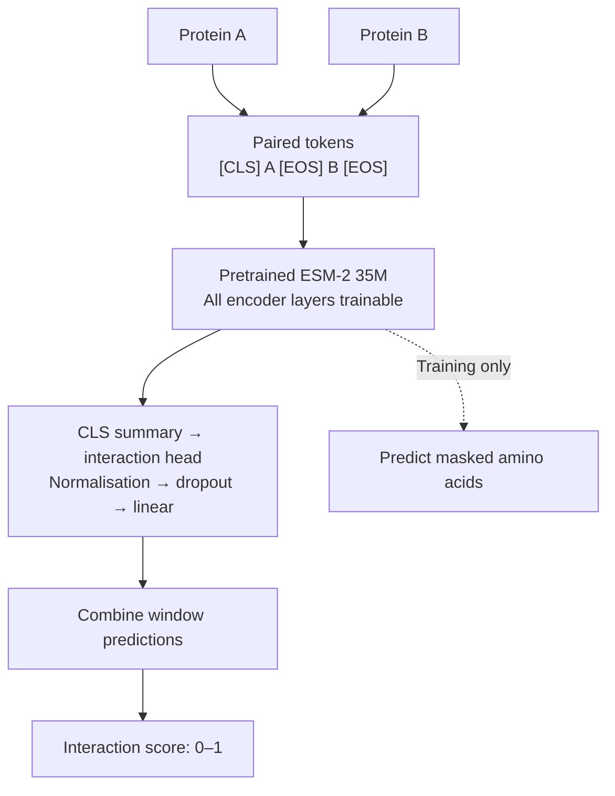

# InterSeq

InterSeq predicts whether two proteins interact from their amino-acid sequences.
It fine-tunes Meta's pretrained ESM-2 weights, updating every encoder layer and
learning an interaction head.

## How it works

1. Read protein pairs labelled as interacting (`1`) or non-interacting (`0`).
2. Load pretrained ESM-2 35M weights.
3. Tokenise both sequences together, using smaller windows for long proteins.
4. Produce an interaction prediction for each pair.
5. Compare predictions with the labels and update the model. During training,
   the model also learns to recover masked amino acids.
6. Evaluate on separate validation pairs and save the best checkpoint.
7. Score new pairs from `0` to `1`. Higher scores indicate predicted interactions.

## Architecture



The CLS token summarises the paired input. The interaction head uses this
summary to predict an interaction. Training combines interaction loss with
masked amino-acid prediction loss, weighted by `0.1` by default.

During inference, InterSeq combines both input orders so swapping the two
proteins produces the same score.

## Install

Requires Python 3.10 or later. For NVIDIA GPU training, use a CUDA-enabled
PyTorch installation.

```bash
pip install -e .
interseq --help
```

## Prepare the data

Use a CSV or compressed CSV with these columns:

```csv
sequence_a,sequence_b,label,split
ACDEFGHIK,LMNPQRSTV,1,train
WWWWAAAA,CCCCDDDD,0,train
EEEEFFFF,GGGGHHHH,1,validation
IIIIKKKK,LLLLMMMM,0,validation
```

Training and validation must each contain both labels. InterSeq preserves your
supplied splits; prepare any protein or sequence separation before training.
An optional `pair_id` column identifies each row. Separate validation files are
supported through `--validation-data`.

## Study data

```bash
interseq-study prepare --output data/study
```

The study preserves the [Bernett gold-standard splits](https://doi.org/10.1093/bib/bbae076):
163,192 HIPPIE-derived training pairs, 59,260 validation pairs and 52,048 final
test pairs. The authors' corrected version 4 FASTA is pinned alongside their
original pair files. A second final test contains 55,000 yeast pairs from
[D-SCRIPT](https://doi.org/10.1016/j.cels.2021.08.010), independently derived
from STRING. Both test sets are stored separately from the development CSV.

Preparation verifies hashes, counts and exact protein/sequence separation,
preserves the published rows, and records data-quality issues in `audit.json`.
See [the evaluation protocol](docs/evaluation.md) for the split details,
pretraining limitations and requirements for comparing published results.

## Train on a GPU

```bash
interseq train --data pairs.csv.gz --output runs/esm2 --device cuda:0
```

The default model is `facebook/esm2_t12_35M_UR50D`. Weights download on the first
run. Each process trains on one GPU; use `cuda:1` to select another. Automatic
precision selects BF16 where supported, otherwise FP16 on CUDA.

Checkpoints are saved every 25 updates. Validation runs every 1,000 updates and
at epoch ends, selecting the best checkpoint by AUROC.

Resume an interrupted run with the same data and settings:

```bash
interseq train --data pairs.csv.gz --output runs/esm2 --device cuda:0 --resume
```

Full checkpoints include model weights, optimiser state and training progress.
Keep the source code and library versions unchanged when resuming.

## Check training performance

```bash
pip install -e '.[benchmark]'
interseq-benchmark --data pairs.csv.gz --output runs/benchmark --device mps
```

Use `--device cuda:0` on an NVIDIA GPU. The benchmark runs 35 training updates,
excludes the first five from timing statistics, reloads the checkpoint and
resumes for one update, then validates every pair in the supplied validation
split. It checks encoder updates, saved predictions and checkpoint recovery.
Use a new output directory for each run.

`benchmark.json` records the configuration, data and source hashes, library
versions, timing distributions and memory measurements. Training, validation,
metrics and checkpoint I/O are timed separately. CUDA memory peaks come from
the allocator; process RSS and Apple GPU peaks are sampled every 50 ms and may
miss brief allocations. Apple GPU and process memory overlap and must not be
added together. Raw measurements and live progress are saved alongside the report.

Full validation can take substantial time. `--hours` defaults to three hours;
an interrupted or incomplete check is reported as a failure. An explicit
`--validation-pairs N` limits validation for a smoke test and is labelled as a
sample. These checks measure workflow correctness and local performance;
they do not establish final model quality.

## Predict and evaluate

```bash
interseq predict --data new_pairs.csv --run runs/esm2 --predictions predictions.csv
interseq evaluate --data test.csv --run runs/esm2 --predictions test_predictions.csv
```

Both commands use the best checkpoint by default. Prediction files need the
two sequence columns; evaluation files also need labels. Output preserves row
order and includes each pair's interaction score.

## Other options

| Option | Purpose |
| --- | --- |
| `--architecture esm2-650m` | Use the larger pretrained ESM-2 model. |
| `--batch-size` and `--accumulation` | Adjust the effective training batch size. |
| `--max-tokens` and `--max-views` | Control sequence window size and coverage. |
| `--initialization random` | Train a randomly initialised baseline in a separate run. |

Run `interseq train --help` for all training options.
