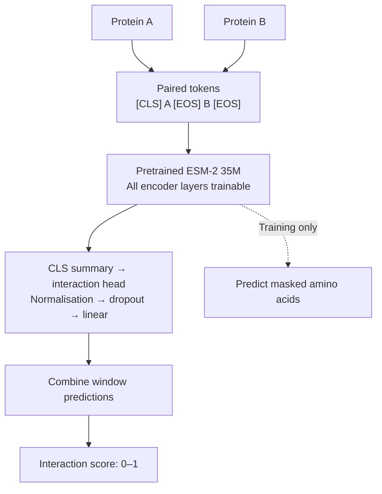

# InterSeq

InterSeq predicts whether two proteins interact from their amino-acid sequences.
It fine-tunes Meta's pretrained ESM-2 weights, updating every encoder layer and
learning an interaction head.

## How it works

1. Read protein pairs labelled as interacting (`1`) or non-interacting (`0`).
2. Load pretrained ESM-2 35M weights.
3. Tokenise both sequences together, using smaller windows for long proteins.
4. Produce an interaction prediction for each pair.
5. Compare predictions with the labels and update the model. During training,
   the model also learns to recover masked amino acids.
6. Evaluate on separate validation pairs and save the best checkpoint.
7. Score new pairs from `0` to `1`. Higher scores indicate predicted interactions.

## Architecture



The CLS token summarises the paired input. The interaction head uses this
summary to predict an interaction. Training combines interaction loss with
masked amino-acid prediction loss, weighted by `0.1` by default.

During inference, InterSeq combines both input orders so swapping the two
proteins produces the same score.

## Install

Requires Python 3.10 or later. For NVIDIA GPU training, use a CUDA-enabled
PyTorch installation.

```bash
pip install -e .
interseq --help
```
